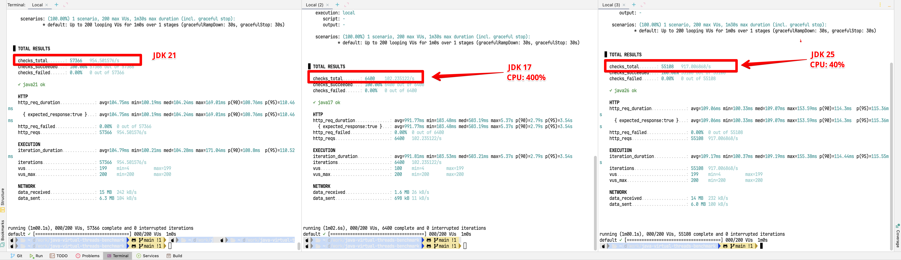

<!-- _class: lead -->
<!-- _paginate: false -->

# Java 17 vs<br>Virtual Threads

**50 new OS threads per request**

The leading explanation for the performance gap

<p class="meta">Benchmark findings · 13 November 2026</p>

<!--
The code confirms the executor lifecycle. It strongly suggests a cause for the observed throughput and CPU gap, but a CPU profile is still needed to attribute the exact cost. The benchmark uses sleeping tasks as a proxy for waiting on I/O. Review sources: the supplied k6 screenshot and ConcurrentTaskService.java in each of java17, java21, and java25.
-->

---

## About nine times the throughput

| Screenshot metric | Java 17 | Java 21 | Run labeled Java 25* |
| :--- | ---: | ---: | ---: |
| Requests / second | 102 | **955** | **917** |
| Average latency | 992 ms | 105 ms | 109 ms |
| p95 latency | 3.54 s | 110 ms | 115 ms |
| HTTP failures | 0% | 0% | 0% |

**9.3×** higher throughput for Java 21 in this run

<p class="note">*The right-hand run has conflicting version labels. The screenshot reports totals over a ramp, rather than a constant-load plateau.</p>

<!--
Source: supplied screenshot. Exact throughput: Java 17 102.235122/s, Java 21 954.501576/s, right-hand run 917.006868/s. Ratio 954.501576 / 102.235122 = 9.3363. Completed requests: 6,400, 57,366, and 55,108. The red annotation calls the right-hand run JDK 25, while its check label says java26 ok. The java25 build and Dockerfile target Java 25, while BenchmarkController.java hardcodes javaVersion as 26. Runtime JDK identity needs an actual runtime check.
-->

---

## The workload spends 100 ms waiting

```http
GET /benchmark/concurrent?tasks=50&delay=100
```

1. Each request submits **50 concurrent tasks**.
2. Each task calls `Thread.sleep(100)`.
3. The request waits for **all 50 tasks** to finish.

<p class="highlight">With enough capacity, response time stays near <strong>100 ms</strong>.</p>

<p class="note">Sleep models waiting. It does not exercise a real database, network dependency, or CPU-heavy workload.</p>

<!--
Sources: BenchmarkController.java and ConcurrentTaskService.java in all three modules, plus k6/ramp-up.js. The tasks execute concurrently, so the intended wait is about 100 ms per request rather than 50 times 100 ms. Additional execution, scheduling, HTTP, and completion overhead remains.
-->

---

## Java 17 creates a pool per request

```java
ExecutorService executor =
    Executors.newFixedThreadPool(tasks);
try {
    // Submit 50 tasks and wait for completion
    CompletableFuture.allOf(...).join();
} finally {
    executor.shutdown();
}
```

**The next request creates another 50 OS threads.**

<p class="note">The pool can reuse workers during its lifetime. This lifecycle prevents reuse across HTTP requests.</p>

<!--
Source: java17/src/main/java/com/meutudo/benchmarkjava17/ConcurrentTaskService.java lines 17–31. The snippet omits submission details for readability. A fresh fixed pool starts workers as tasks are submitted. Here 50 submissions to a fresh pool with 50 core workers result in 50 workers during a successful call. There is no single global 50-worker task queue.
API reference: https://docs.oracle.com/en/java/javase/17/docs/api/java.base/java/util/concurrent/Executors.html#newFixedThreadPool(int)
-->

---

## Thread creation becomes substantial

<p class="metric">≈ 5,100</p>

OS threads created and terminated per second

<p class="equation">102 requests/s × 50 threads/request</p>

### Potential demand at 200 active requests

**200 × 50 = 10,000 task threads**, plus request and JVM threads

<p class="note">These are calculations from the workload and observed throughput. The review did not measure thread-start rates or peak thread counts.</p>

<!--
Sources: Java 17 screenshot throughput and the confirmed per-request pool implementation. The approximate creation rate assumes successful calls submit the configured 50 tasks. 102.235122 times 50 is about 5,112 threads/second over the aggregate run. The 10,000 figure is potential concurrent task-thread demand if 200 HTTP requests are simultaneously executing this service. It is not 10,000 tasks per second and is not a measured live thread count.
-->

---

## High CPU can come from thread overhead

`Thread.sleep(100)` suspends execution instead of busy-waiting.

- Native thread creation initializes OS and JVM resources.
- Starting and waking workers adds scheduling work.
- Pool shutdown adds thread cleanup on every request.
- Completion coordination and allocation add more overhead.

**These costs are likely contributors. A profile must quantify them.**

<p class="note">The CPU annotations show 400% vs 40%. On a per-core scale, 400% means about four logical CPUs busy. The source and sampling interval are unknown.</p>

<!--
Observed evidence: user CPU annotations in the screenshot, not k6 measurements. Code evidence: fresh native worker pools per request. Attribution to creation, scheduling, allocation, or cleanup remains a hypothesis until measured. A sleeping OS thread is not continuously runnable, so a large live thread count alone does not prove constant scheduler thrashing. Do not attribute all CPU usage to context switching. CPU scales vary across operating-system monitors, Docker, and normalized JVM metrics.
API reference: https://docs.oracle.com/en/java/javase/17/docs/api/java.base/java/lang/Thread.html#sleep(long)
-->

---

## Virtual threads release the carrier while waiting

```java
try (ExecutorService executor =
    Executors.newVirtualThreadPerTaskExecutor()) {
    // Submit the same 50 sleeping tasks
    CompletableFuture.allOf(...).join();
}
```

- The JVM schedules virtual threads on shared OS carriers.
- During sleep, a virtual thread can unmount from its carrier.
- Many waiting tasks can share a much smaller OS thread set.

**Observed average latency stays near the intended 100 ms wait.**

<!--
Sources: java21 and java25 ConcurrentTaskService.java, executor creation at line 17. Each executor starts one virtual thread per task and does not create a new private OS carrier pool for every request. Oracle's virtual-thread guide explains suspension and carrier reuse, and states that virtual threads improve throughput and scale rather than individual CPU execution speed.
Reference: https://docs.oracle.com/en/java/javase/21/core/virtual-threads.html
Implementation reference for sleep and scheduling: https://openjdk.org/jeps/444
-->

---

## Slower responses reduce k6 throughput

Each virtual user sends a request, waits for its response,<br>then begins the next iteration.

<p class="equation">Throughput ≈ active users / response time</p>

- Longer responses let each user complete fewer requests.
- The screenshot ramps toward **200 users over one minute**.
- Its average mixes lighter load with the busiest part of the run.

<p class="note">The formula describes a stable closed workload with negligible think time. It is not an exact calculation for this changing ramp.</p>

<!--
Sources: screenshot scenario text and k6/ramp-up.js. Each enabled iteration issues one synchronous HTTP request and has no explicit sleep. The screenshot shows one stage lasting one minute. At slide creation, the locally modified script shows a two-minute ramp, so it is not an exact reproduction of the screenshot configuration. VU counts and average response times vary throughout the run. Avoid substituting the maximum 200 users into this formula to predict aggregate throughput.
-->

---

## The comparison changes more than the JDK

| Dimension | Java 17 app | Java 21/25 apps |
| :--- | :--- | :--- |
| Task executor | Fresh platform pool | Virtual thread per task |
| Spring virtual threads | Disabled by default | Explicitly enabled |
| Blocking work | 50 sleeps × 100 ms | 50 sleeps × 100 ms |

- The threading design is a major difference in this test.
- The review has no CPU profile or verified runtime version log.
- A single ramp does not establish sustained production capacity.

<!--
Sources: service implementations and application.properties. Java 21 and 25 set spring.threads.virtual.enabled=true, Java 17 has no such setting. The current build.gradle files all use Spring Boot 3.5.16, contrary to older README descriptions, so this deck does not attribute the gap to different Spring Boot versions. Changing Spring's virtual-thread setting can also change request handling, beyond the explicit executor inside the service.
Spring reference: https://docs.spring.io/spring-boot/3.5/reference/features/task-execution-and-scheduling.html
-->

---

## A controlled comparison can isolate the costs

| Comparison | What it isolates |
| :--- | :--- |
| Fresh vs shared platform pool on JDK 17 | Thread lifecycle overhead |
| Same platform design on JDK 17, 21, 25 | JDK-version effects |
| Platform vs virtual tasks on one newer JDK | Task-thread strategy |
| Same task executor, Spring virtual on vs off | Request-thread strategy |

**Warm-up, then a fixed-load plateau with matching resources.**

<p class="note">Collect CPU profiles, thread-start rates, and scheduling evidence. A bounded shared pool still queues work when every worker is sleeping.</p>

<!--
Proposed validation, not completed testing. Keep workload parameters, Spring Boot, HTTP threading configuration where applicable, CPU/memory limits, JVM flags, and monitoring scales consistent. Shared-pool capacity must be declared because reducing native thread creation also introduces a concurrency limit and queueing. Verify actual java -version in each running process/container. Repeated separate runs reduce interference and establish variability.
-->

---

## The findings support a clear next step

1. **Reuse platform workers** to measure how much thread creation costs.
2. **Keep virtual threads** as the comparison for many waiting tasks.
3. **Profile under sustained load** before assigning the 400% CPU cost.

<p class="highlight">The main finding is the cost of <strong>50 fresh OS threads per request</strong>.</p>

<p class="note">The evidence does not establish a general 9× JDK speedup or a comparable benefit for CPU-heavy work.</p>

<!--
Evidence summary: source inspection confirms the per-request pool and virtual-thread alternative. Screenshot measurements confirm the throughput and latency gap in this run. The CPU breakdown remains unmeasured. No application changes or new benchmark runs form part of this presentation.
Reference: https://docs.oracle.com/en/java/javase/21/core/virtual-threads.html
-->

---

<!-- _class: evidence -->

## Appendix: original benchmark evidence



<p class="note">Original screenshot, preserved in full. The results slide extracts its metrics at presentation size.</p>

<p class="note">Version labels conflict in the right-hand run. CPU values are user annotations. Both limitations remain open until runtime verification and profiling.</p>

<!--
Image source: screenshot supplied by the user in this conversation, preserved without cropping or alteration. The appendix retains all three terminal panels and the original annotations. The source note is 2026-11-13 Java 17 vs Virtual Threads - Throughput and CPU Analysis in the obsidianspace vault.
Official references used in the findings:
https://docs.oracle.com/en/java/javase/17/docs/api/java.base/java/util/concurrent/Executors.html#newFixedThreadPool(int)
https://docs.oracle.com/en/java/javase/21/core/virtual-threads.html
https://docs.spring.io/spring-boot/3.5/reference/features/task-execution-and-scheduling.html
-->
